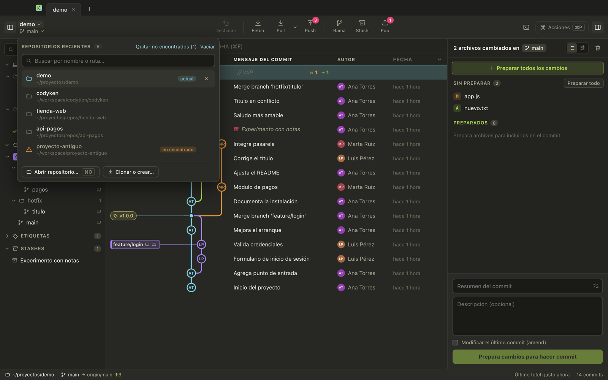
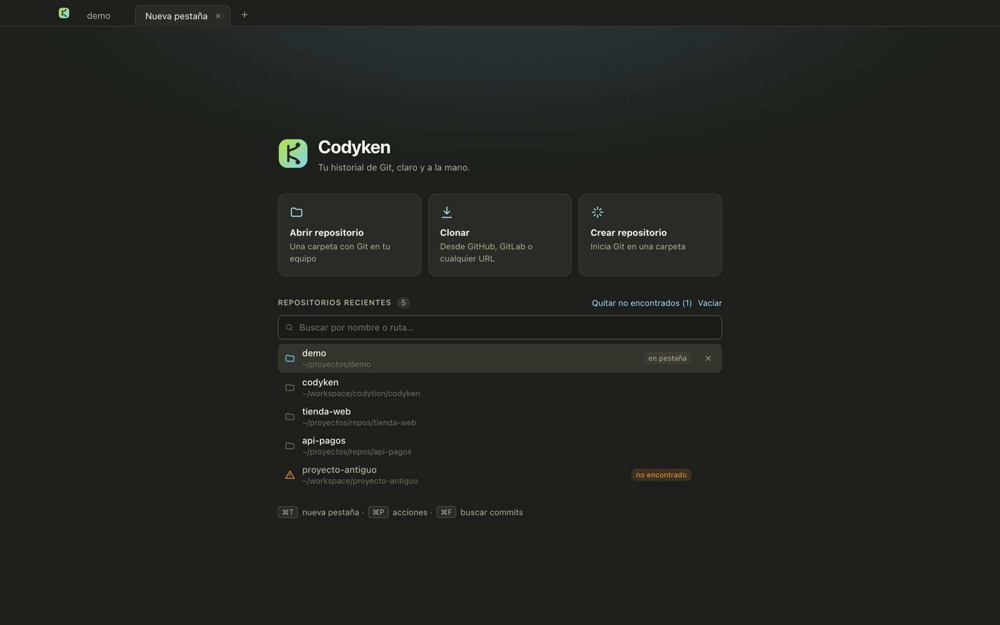

<div align="center">


# Codyken

**Cliente Git de escritorio, rápido y visual, con tema oscuro Monokai.**

Historial en gráfico, staging por línea, ramas locales y remotas lado a lado y deshacer con ⌘Z.<br/>
Funciona sobre el `git` de tu equipo: mismo comportamiento, mismas credenciales, mismos hooks.


[Características](#-características) · [Empezar](#-empezar) · [Atajos](#️-atajos) · [Arquitectura](#️-arquitectura) · [Documentación](#-documentación)

</div>


<sub>Las capturas usan un repositorio de demostración con `main`, `feature/login`, `feature/pagos`, `hotfix/titulo`, una etiqueta y un stash.</sub>

## ✨ Por qué Codyken

| | |
|---|---|
| 🌳 **Gráfico legible** | Orden cronológico, rama actual siempre en la primera columna y carriles cortos aunque haya decenas de ramas de despliegue. |
| ✂️ **Commits precisos** | Prepara archivos, bloques o líneas sueltas con un clic; diff con resaltado de sintaxis. |
| 🔁 **Sin miedo a equivocarte** | Deshacer (⌘Z) para commits, merges, rebases, pulls, checkouts y ramas borradas. |
| 🗂️ **Todos tus repos a mano** | Lista de repositorios recientes con búsqueda (⇧⌘O) y pestañas que se restauran al abrir. |
| 🔒 **Seguro por diseño** | Renderer aislado, una sola API con lista cerrada y git ejecutado sin shell ni prompts de credenciales. |

## 🚀 Características

### Gráfico de commits

- Cada commit muestra las **iniciales del autor**; los merges son un punto y HEAD lleva un anillo.
- Las **etiquetas de rama** se unen a su commit con una línea del color del carril. Local y remota juntas cuando coinciden (💻 ☁); las que solo están en el remoto, punteadas.
- Fila **`// WIP`** con el conteo de cambios, donde puedes escribir el resumen del commit.
- Los **stashes** aparecen como nodos cuadrados colgados del commit donde se guardaron.
- Búsqueda por mensaje, autor o SHA (⌘F), columnas configurables, carga por páginas de 2000 commits y lista virtualizada.
- **Arrastra** una rama sobre otra para hacer merge o rebase.

### Repositorios recientes

Cada repo que abres, clonas o creas queda en una lista (hasta 50) para volver a cargarlo con un clic. Se abre desde el **nombre del repo** en la barra o con **⇧⌘O**, y también aparece en cada pestaña nueva.

- Búsqueda por nombre o ruta, ↑ ↓ y Enter. Si el repo ya tiene pestaña, salta a ella.
- Etiquetas **actual**, **en pestaña** y **no encontrado** (la carpeta se movió o se borró).
- Quita elementos con **✕** o con clic derecho, limpia de golpe los que ya no existen o **vacía** la lista. Solo se toca la lista: ni archivos ni pestañas.

<table>
  <tr>
    <td width="50%"></td>
    <td width="50%"></td>
  </tr>
  <tr>
    <td align="center"><sub>Desde la barra: clic en el nombre del repo o ⇧⌘O</sub></td>
    <td align="center"><sub>En cada pestaña nueva, junto a abrir, clonar y crear</sub></td>
  </tr>
</table>

### Cambios y commit

- Staging **por archivo, por bloque o por línea**: selecciona líneas (Mayús para un rango) y elige *Preparar* o *Descartar*.
- Diff con **resaltado de sintaxis**, cambios dentro de la línea y tres vistas: Bloques, Archivo completo y Dividido.
- Archivos en **lista o árbol de carpetas**; prepara o quita una carpeta entera de una vez.
- Resumen con contador de 72 caracteres, descripción opcional y **amend**.


### Ramas: ocultar, filtrar y comparar local con remoto

- El **ojo** junto a cada rama, carpeta o remoto la quita del gráfico; una rama local se oculta junto con su remota para que sus commits desaparezcan de verdad. También existe **Mostrar solo esta rama**.
- En el panel izquierdo: ☁ si la rama está al día con su remota, `↑n` / `↓n` si difiere, `local` si nunca se subió y 💻 en las remotas que también tienes en local.
- El filtro se guarda por repositorio y se avisa en la búsqueda, en el panel y en la barra de estado.

<table>
  <tr>
    <td width="50%"></td>
    <td width="50%"></td>
  </tr>
  <tr>
    <td align="center"><sub>Ramas ocultas con su remota</sub></td>
    <td align="center"><sub>Stash en el gráfico: aplicar, pop o eliminar</sub></td>
  </tr>
</table>

### Historial y blame de un archivo

- **Historial**: todos los commits que tocaron el archivo, siguiendo renombres, con el diff de cada uno.
- **Blame**: cada línea con el commit, autor y fecha que la introdujo, agrupadas y coloreadas por commit.

<table>
  <tr>
    <td width="50%"></td>
    <td width="50%"></td>
  </tr>
</table>

### Deshacer

**Deshacer** (⌘Z) revierte commit, amend, checkout, crear/eliminar/renombrar rama, etiquetas, merge, rebase, pull, cherry-pick, revert y reset. El tooltip dice qué se va a deshacer.

- Solo actúa si HEAD sigue donde lo dejó la acción: si cambiaste algo desde la terminal, avisa y no toca nada.
- Deshacer un commit devuelve los cambios a preparados y recupera el mensaje.
- Lo que requiere `reset --hard` pide confirmación y un árbol de trabajo limpio.

### Remotos y conflictos

- **Fetch** de todos los remotos (también automático cada 10 minutos).
- **Pull** en tres modos — fast-forward si es posible, solo fast-forward o rebase — con modo predeterminado configurable.
- **Push** que crea la rama remota si falta y, si el remoto la rechaza, ofrece `--force-with-lease`.
- Merge, rebase o cherry-pick con conflictos: aviso con **Abortar / Continuar** y resolución por archivo (*Usar versión HEAD*, *Usar versión entrante*, *Marcar resuelto*).

### Paleta de comandos

**⌘P** abre una búsqueda aproximada sobre todas las acciones, el checkout de cualquier rama, saltar a una rama en el gráfico y abrir repositorios recientes.


## 🏁 Empezar

Requisitos: **Node 22+** y **git** en el PATH.

```bash
git clone https://github.com/godie007/codyken.git
cd codyken
npm install
npm run dev
```

| Comando | Qué hace |
|---|---|
| `npm run dev` | App con recarga en caliente del renderer |
| `npm run build` | Compila main, preload y renderer a `out/` |
| `npm start` | Abre la versión compilada |
| `npm test` | Tests con vitest: gráfico, diffs, staging parcial, git real y lista de recientes |
| `npm run typecheck` | TypeScript estricto en los dos proyectos (node y web) |

<details>
<summary><strong>Modo captura (para documentación)</strong></summary>

Solo en desarrollo. Abre un repo, ejecuta un script opcional, guarda un PNG de la ventana y cierra. Usa sus propios ajustes, así que no toca los tuyos.

```bash
npx electron-vite build
CODYKEN_SNAPSHOT=foto.png CODYKEN_OPEN=/ruta/repo npx electron .
```

Opcionales: `CODYKEN_SNAPSHOT_JS` (script que se ejecuta antes de la foto), `CODYKEN_SNAPSHOT_DELAY` y `CODYKEN_SNAPSHOT_SETTLE` (esperas en ms).

</details>

## ⌨️ Atajos

| Acción | Atajo | | Acción | Atajo |
|---|---|---|---|---|
| Paleta de comandos | ⌘P | | Commit | ⌘Enter |
| Repositorios recientes | ⇧⌘O | | Preparar todo y commit | ⇧⌘Enter |
| Abrir repositorio | ⌘O | | Preparar / quitar todo | ⇧⌘S / ⇧⌘U |
| Buscar commits | ⌘F | | Escribir mensaje de commit | ⇧⌘M |
| Filtrar ramas | ⌥⌘F | | Deshacer la última acción | ⌘Z |
| Nueva rama | ⌘B | | Panel izquierdo / derecho | ⌘J / ⌘K |
| Fetch | ⌘L | | Moverse por el gráfico | ↑ ↓ · J K |
| Nueva pestaña / cerrar | ⌘T / ⌘W | | Preparar / quitar archivo abierto | S / U |
| Ir a la pestaña N | ⌘1 … ⌘9 | | Cerrar diff, historial o blame | Esc |

## 🏗️ Arquitectura

```
┌────────────────────────────┐   un canal IPC   ┌─────────────────────────────┐
│ Renderer (React)           │ ───────────────▶ │ Main (Electron / Node)      │
│ sin Node, sandbox, CSP     │   codyken:api    │ lista cerrada de handlers   │
│ components/ · lib/         │ ◀─────────────── │ git.ts → spawn("git", args) │
└────────────────────────────┘                  └─────────────────────────────┘
```

```
src/main/          proceso principal: git.ts (todas las operaciones), watcher, ajustes, IPC
src/preload/       puente seguro (contextIsolation + sandbox)
src/shared/        tipos, contrato de la API y reglas compartidas
src/renderer/      React: components/ (vistas) y lib/ (gráfico, diff, parches, resaltado, búsqueda)
tests/             vitest
codyken-obsidian/  documentación completa (bóveda de Obsidian) y capturas
```

**Seguridad.** El renderer no tiene acceso a Node y solo llama métodos de una lista cerrada. Git se ejecuta sin shell (argumentos en arreglo), con cada referencia validada, sin pedir credenciales por terminal (`GIT_TERMINAL_PROMPT=0`, SSH en modo batch) y solo sobre repositorios que abriste.

## 📚 Documentación

La documentación técnica completa vive en la bóveda de Obsidian [`codyken-obsidian/`](codyken-obsidian/00%20-%20Inicio.md): arquitectura, capa git, algoritmos del gráfico, interfaz, flujos de trabajo paso a paso, tests y registro de decisiones. Ábrela en Obsidian con *Abrir carpeta como bóveda* y empieza por `00 - Inicio`.

## 🗺️ Hoja de ruta

- [x] Gráfico con carriles, stashes y ramas locales/remotas
- [x] Staging por línea, historial, blame y deshacer
- [x] Lista de repositorios recientes con búsqueda y limpieza
- [ ] Rehacer y rebase interactivo
- [ ] Comparar dos commits o ramas
- [ ] Terminal integrada
- [ ] Empaquetado `.dmg` firmado
- [ ] Pull requests de GitHub/GitLab, worktrees y LFS
- [ ] Editor de conflictos de tres paneles
