<div align="center">


# Codyken

**Cliente Git de escritorio, rápido y visual, con tema oscuro Monokai.**

Historial en gráfico, staging por línea, arrastrar y soltar ramas, rebase interactivo y deshacer/rehacer con ⌘Z / ⇧⌘Z.<br/>
Funciona sobre el `git` de tu equipo: mismo comportamiento, mismas credenciales, mismos hooks.


[Características](#-características) · [Empezar](#-empezar) · [Atajos](#️-atajos) · [Arquitectura](#️-arquitectura) · [Documentación](#-documentación)

</div>


<sub>Las capturas usan un repositorio de demostración con `main`, `feature/login`, `feature/pagos`, `hotfix/titulo`, una etiqueta y un stash.</sub>

## ✨ Por qué Codyken

| | |
|---|---|
| 🌳 **Gráfico legible** | Orden cronológico, rama actual siempre en la primera columna y carriles cortos aunque haya decenas de ramas de despliegue. |
| ✂️ **Commits precisos** | Prepara archivos, bloques o líneas sueltas con un clic; diff con resaltado de sintaxis. |
| 🖱️ **Arrastra y suelta** | Suelta una rama sobre otra o sobre su remota: fast-forward, merge, rebase, push o pull request. |
| 🔁 **Sin miedo a equivocarte** | Deshacer (⌘Z) y rehacer (⇧⌘Z) para commits, merges, rebases, pulls, checkouts y ramas borradas. |
| 🗂️ **Todos tus repos a mano** | Lista de repositorios recientes con búsqueda (⇧⌘O) y pestañas que se restauran al abrir. |
| 🔒 **Seguro por diseño** | Renderer aislado, una sola API con lista cerrada y git ejecutado sin shell ni prompts de credenciales. |

## 🚀 Características

### Gráfico de commits

- Cada commit muestra las **iniciales del autor**; los merges son un punto y HEAD lleva un anillo.
- Las **etiquetas de rama** se unen a su commit con una línea del color del carril. Una rama en el mismo commit en local y en sus remotos es **una sola etiqueta** (💻 ☁); si difieren, dos, con `↑n` / `↓n`; las que solo están en el remoto llevan ☁ y un relleno más suave.
- Fila **`// WIP`** con el conteo de cambios, donde puedes escribir el resumen del commit.
- Los **stashes** aparecen como un commit más (cuadrado punteado) **justo encima del commit donde se guardaron**, también si su rama ya no existe. Al seleccionarlo: *Aplicar*, *Aplicar y eliminar (pop)* o *Eliminar*; doble clic lo aplica.
- Búsqueda por mensaje, autor o SHA (⌘F), columnas configurables, carga por páginas de 2000 commits y lista virtualizada.
- **⌘‑clic** en otro commit para compararlo con el seleccionado.
- Los **mensajes largos** llegan hasta el borde de su columna y se desplazan a los lados con el trackpad, Mayús + rueda o la barra inferior.
- El **detalle del commit** interpreta el mensaje: tipo y alcance como etiquetas (`fix`, `seguridad`), párrafos que aprovechan el ancho, títulos, viñetas, código y coautores aparte.

### Arrastrar y soltar ramas

Arrastra cualquier rama —local o remota, desde el gráfico o desde el panel izquierdo— y suéltala sobre otra. El menú solo ofrece lo que tiene sentido según cómo estén las dos ramas:

| Arrastras… | …y sueltas sobre | Opciones |
|---|---|---|
| una rama local | otra rama local | Fast-forward (si es directo), merge en ella, rebase encima de ella, rebase interactivo |
| una rama local | su remota u otra remota | Push (o push forzado con `--force-with-lease` si divergen), rebase sobre la remota |
| una rama remota | una rama local | Fast-forward de la local, merge o rebase de la local sobre la remota |
| una rama local | el remoto (`origin`) en el panel | Publicarla allí y dejarla siguiendo a la remota |
| cualquiera | otra rama de GitHub/GitLab | Crear el pull request de una a otra (la sube antes si hace falta) |

Las operaciones locales se deshacen con ⌘Z. La rama que recibe la acción se marca mientras la arrastras.

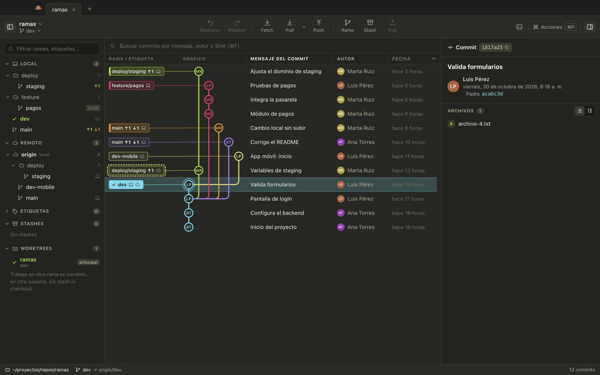

### Rebase interactivo

Desde un commit (*Rebase interactivo desde aquí…*) o arrastrando una rama sobre otra (*Rebase interactivo de X sobre Y…*): reordena arrastrando las filas, y elige para cada commit **conservar, reescribir el mensaje, combinar con el anterior (con o sin su mensaje) o descartar**. Guarda los cambios sin confirmar en un stash automático y se deshace con ⌘Z.

<table>
  <tr>
    <td width="50%">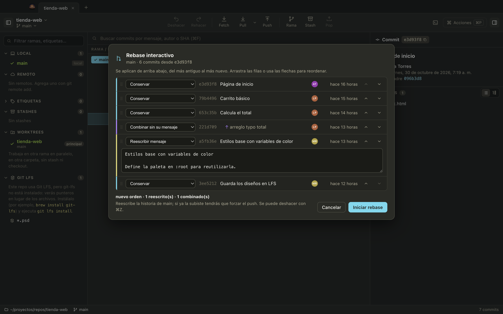</td>
    <td width="50%">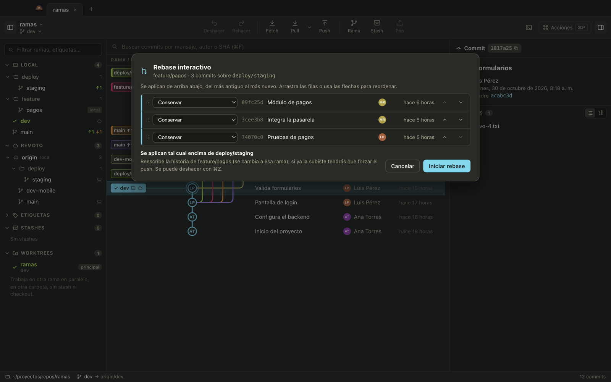</td>
  </tr>
  <tr>
    <td align="center"><sub>Reordenar, combinar y reescribir en la misma rama</sub></td>
    <td align="center"><sub>Llevar una rama encima de otra</sub></td>
  </tr>
</table>

### Comparar dos commits o ramas

Selecciona un commit y haz **⌘‑clic** en otro, o usa *Comparar con HEAD* (en un commit) o *Comparar con* la rama actual (en una rama) del menú contextual. El panel derecho muestra los commits que tiene cada lado y los archivos que difieren; cada archivo abre su diff entre los dos puntos. **⇄** invierte los lados y Esc cierra la comparación.

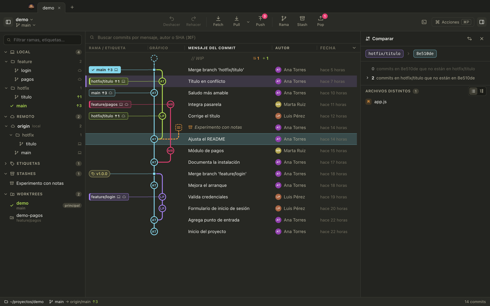

### Repositorios recientes

Cada repo que abres, clonas o creas queda en una lista (hasta 50) para volver a cargarlo con un clic. Se abre desde el **nombre del repo** en la barra o con **⇧⌘O**, y también aparece en cada pestaña nueva.

- Búsqueda por nombre o ruta, ↑ ↓ y Enter. Si el repo ya tiene pestaña, salta a ella.
- Etiquetas **actual**, **en pestaña** y **no encontrado** (la carpeta se movió o se borró).
- Quita elementos con **✕** o con clic derecho, limpia de golpe los que ya no existen o **vacía** la lista. Solo se toca la lista: ni archivos ni pestañas.

<table>
  <tr>
    <td width="50%"></td>
    <td width="50%"></td>
  </tr>
  <tr>
    <td align="center"><sub>Desde la barra: clic en el nombre del repo o ⇧⌘O</sub></td>
    <td align="center"><sub>En cada pestaña nueva, junto a abrir, clonar y crear</sub></td>
  </tr>
</table>

### Cambios y commit

- Staging **por archivo, por bloque o por línea**, en los dos sentidos: en *Sin preparar* eliges líneas y las **preparas** (o descartas); en *Preparado* eliges líneas y las **quitas**, y vuelven a *Sin preparar*. Para una sola línea basta el **+** / **−** que aparece sobre su número al pasar el ratón. Vale en varios bloques a la vez (una barra resume la selección; **S** / **U** la aplican, Esc la limpia), en la vista *Dividido* y también en archivos **nuevos, borrados o renombrados**: quitar unas líneas de un archivo nuevo lo deja preparado sin ellas, y en un renombrado se mantiene el renombre.
- Diff con **resaltado de sintaxis**, cambios dentro de la línea y tres vistas: Bloques, Archivo completo y Dividido.
- Archivos en **lista o árbol de carpetas**; prepara o quita una carpeta entera de una vez.
- Resumen con contador de 72 caracteres, descripción opcional y **amend**.


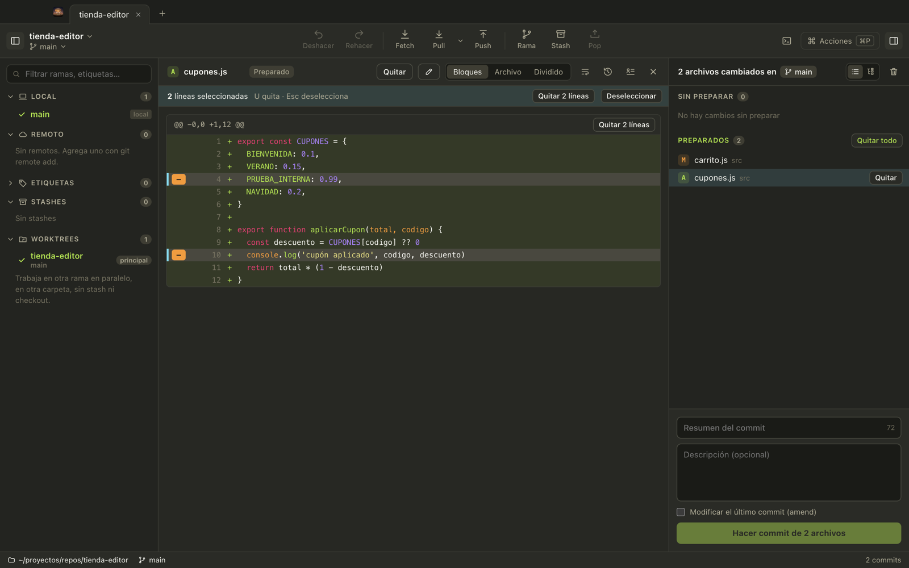

### Editar archivos y retocar lo que preparas

- **Editar** en la barra del diff (o en el menú del archivo) abre el archivo en un editor con resaltado de sintaxis, números de línea y **marcas en el margen** de lo añadido (verde), cambiado (naranja) y borrado (▸ rojo) respecto a lo preparado. ⌘S guarda; *Guardar y preparar* lo deja listo para el commit.
- **Editar la versión preparada**: lo que entra en el commit, sin tocar el archivo en disco (como `git add -e`). Arriba se alterna entre *Archivo* y *Preparado*.
- **Editar archivo con la versión de un commit**: con un commit seleccionado, clic derecho sobre uno de sus archivos. Se abre tu archivo con el contenido que tenía en ese commit; lo ajustas y, al guardar, queda en *Sin preparar* como cualquier cambio (si tenías cambios sin preparar en ese archivo, avisa de que se reemplazan).
- **Editar y preparar…** en un bloque del diff: elige unas líneas, ábrelas sobre la versión preparada, **retócalas** (quita un `console.log`, cambia un texto) y *Preparar esta versión*. El archivo en disco se queda como estaba.
- Tabulador y Mayús+Tab sangran o quitan sangría a varias líneas, Enter conserva la sangría, ⌘G va a una línea y clic en el número selecciona la línea. Respeta CRLF/LF y los permisos del archivo.
- No pisa cambios ajenos: si el archivo cambia por fuera mientras editas, avisa y te deja recargar o mantener lo tuyo; sin cambios propios, se recarga solo. Lo escrito sin guardar sobrevive a cambiar de pestaña.

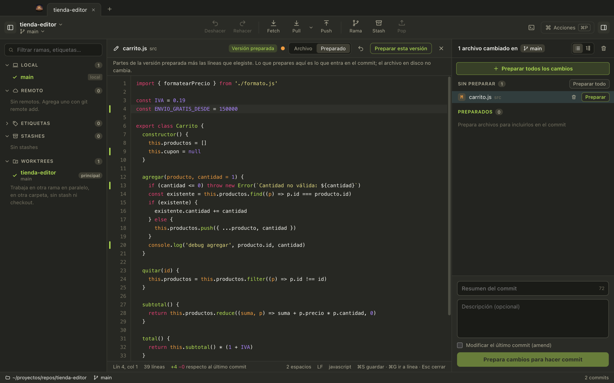

### Ramas: ocultar, filtrar y comparar local con remoto

- El **ojo** junto a cada rama, carpeta o remoto la quita del gráfico; una rama local se oculta junto con su remota para que sus commits desaparezcan de verdad. También existe **Mostrar solo esta rama**.
- En el panel izquierdo: ☁ si la rama está al día con su remota, `↑n` / `↓n` si difiere, `local` si nunca se subió y 💻 en las remotas que también tienes en local.
- Una rama que está igual en local y en el remoto aparece **una sola vez** (en Local, con ☁); en Remoto solo quedan las que difieren o no tienes. Filtrando por su nombre aparece también la remota.
- El filtro se guarda por repositorio y se avisa en un solo lugar: *n ramas ocultas · Mostrar todas*, junto a la búsqueda del gráfico.
- **Eliminar varias ramas**: ⌘‑clic y Mayús‑clic las seleccionan en el panel (o clic derecho sobre una carpeta, un remoto o *Local*). Un diálogo muestra qué se elimina y qué no: nunca la rama actual, una abierta en otro worktree ni la principal del remoto. Las locales se recuperan con Deshacer.

<table>
  <tr>
    <td width="50%"></td>
    <td width="50%"></td>
  </tr>
  <tr>
    <td align="center"><sub>Ramas ocultas con su remota</sub></td>
    <td align="center"><sub>Stash en el gráfico: aplicar, pop o eliminar</sub></td>
  </tr>
  <tr>
    <td width="50%">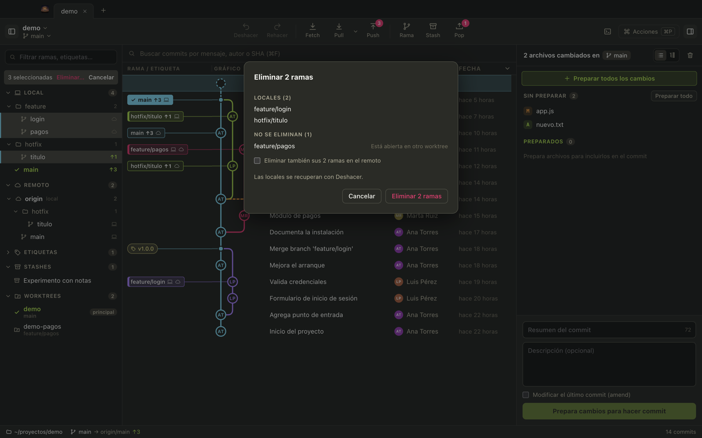</td>
    <td width="50%">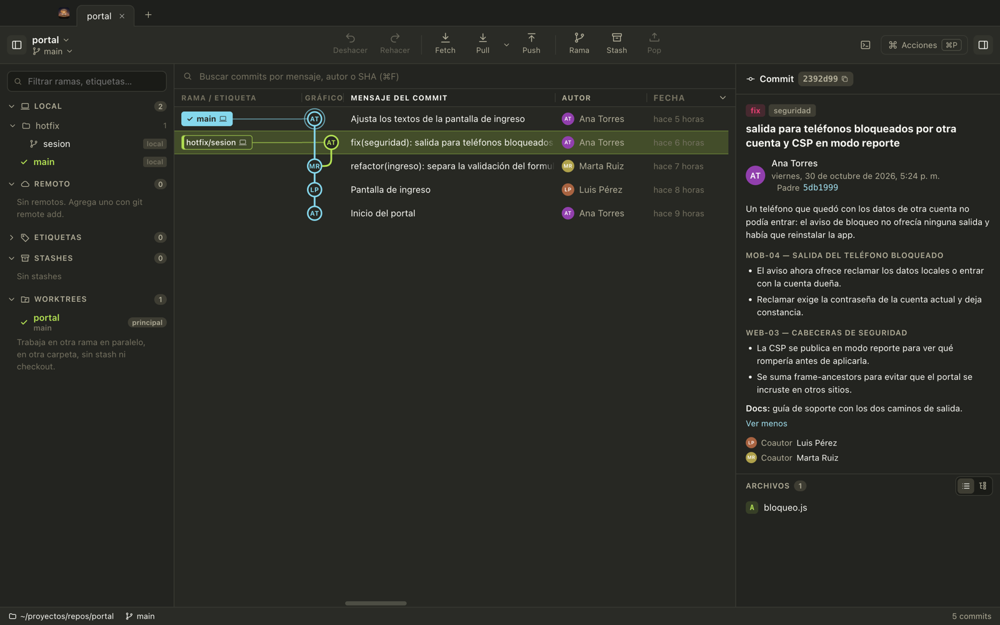</td>
  </tr>
  <tr>
    <td align="center"><sub>Eliminar varias ramas a la vez</sub></td>
    <td align="center"><sub>Mensaje de commit interpretado</sub></td>
  </tr>
</table>

### Historial y blame de un archivo

- **Historial**: todos los commits que tocaron el archivo, siguiendo renombres, con el diff de cada uno.
- **Blame**: cada línea con el commit, autor y fecha que la introdujo, agrupadas y coloreadas por commit.

<table>
  <tr>
    <td width="50%"></td>
    <td width="50%"></td>
  </tr>
</table>

### Deshacer y rehacer

**Deshacer** (⌘Z) revierte commit, amend, checkout, crear/eliminar/renombrar rama, etiquetas, merge, rebase (también el interactivo), fast-forward, pull, cherry-pick, revert y reset. **Rehacer** (⇧⌘Z) vuelve a aplicar lo deshecho; una acción nueva vacía la pila de rehacer. Los tooltips dicen qué se va a deshacer o rehacer.

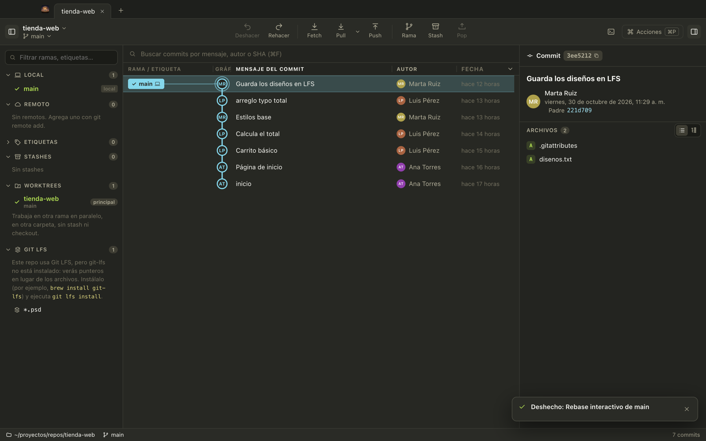

- Solo actúa si HEAD sigue donde lo dejó la acción: si cambiaste algo desde la terminal, avisa y no toca nada.
- Deshacer un commit devuelve los cambios a preparados y recupera el mensaje.
- Lo que requiere `reset --hard` pide confirmación y un árbol de trabajo limpio.

### Remotos

- **Fetch** de todos los remotos (también automático cada 10 minutos) que, además, **adelanta las ramas locales que solo estaban atrasadas** hasta su remota (`git fetch` por sí solo nunca las mueve). La rama actual se adelanta al pulsar Fetch si tus cambios sin confirmar lo permiten. No se tocan las que tienen commits propios: el aviso dice cuáles necesitan pull. Si el clon era superficial, trae la historia completa. Se deshace con ⌘Z.
- **Pull** en tres modos — fast-forward si es posible, solo fast-forward o rebase — con modo predeterminado configurable.
- **Push** que crea la rama remota si falta y, si el remoto la rechaza, ofrece `--force-with-lease`.

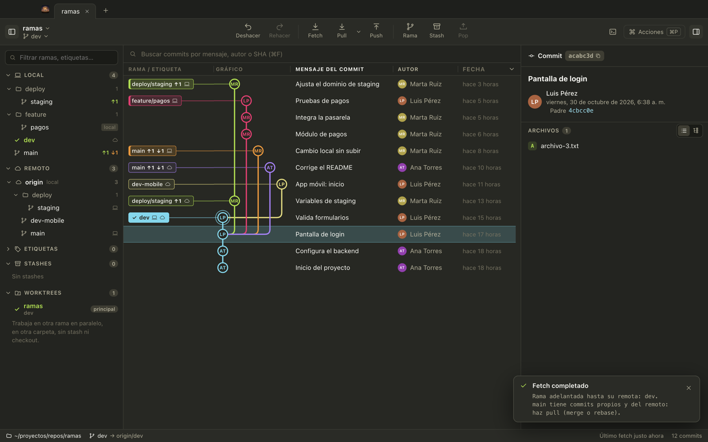

### Editor de conflictos de tres paneles

Con un merge, rebase o cherry-pick en conflicto, el archivo se abre con **tu versión (HEAD) y la entrante** lado a lado y alineadas, y el **resultado** debajo. Marca en cada conflicto qué lado usar (o los dos, en el orden en que los marques, o ninguno); los tramos iguales largos se pliegan. *Siguiente* salta al próximo pendiente, *Todo HEAD* / *Todo entrante* resuelven de golpe y *Editar a mano* convierte el resultado en texto libre. *Guardar y resolver* escribe el archivo y lo prepara.

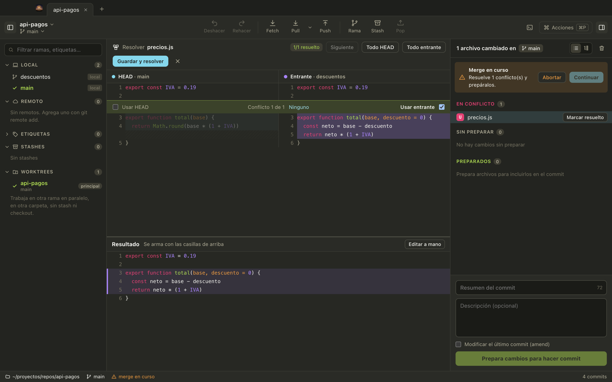

### Pull requests, worktrees y Git LFS

- **Pull requests / merge requests** de GitHub y GitLab en el panel izquierdo (con `gh` o `glab` iniciados): ver, abrir en el navegador, comparar con su base y hacer checkout. *Crear pull request…* abre la página del proveedor con la rama ya elegida.
- **Worktrees**: lista, crear uno nuevo para una rama (se abre en otra pestaña), quitar y limpiar los que ya no existen.
- **Git LFS**: patrones seguidos, archivos sin descargar con *Descargar*, y seguir o dejar de seguir tipos de archivo. Si el repo usa LFS y `git-lfs` no está instalado, lo avisa.

### Paleta de comandos

**⌘P** abre una búsqueda aproximada sobre todas las acciones, el checkout de cualquier rama, saltar a una rama en el gráfico y abrir repositorios recientes.


## 🏁 Empezar

Requisitos: **Node 22+** y **git** en el PATH.

```bash
git clone https://github.com/godie007/codyken.git
cd codyken
npm install
npm run dev
```

| Comando | Qué hace |
|---|---|
| `npm run dev` | App con recarga en caliente del renderer |
| `npm run build` | Compila main, preload y renderer a `out/` |
| `npm start` | Abre la versión compilada |
| `npm test` | Tests con vitest: gráfico, diffs, staging parcial, conflictos, arrastrar y soltar, rebase, worktrees y git real |
| `npm run typecheck` | TypeScript estricto en los dos proyectos (node y web) |
| `npm run install:mac` | Genera `Codyken.app` y la instala en `/Applications` (ver abajo) |
| `npm run package:mac` | Solo genera `dist/Codyken.app` |

### Instalar en macOS

```bash
npm run install:mac
```

Genera la app (nombre, icono y firma ad hoc) a partir del Electron de `node_modules`, **sin instalar nada más**, y la deja en `/Applications`: sale en Launchpad y Spotlight y se puede fijar en el Dock. Comparte ajustes y repositorios recientes con `npm run dev`. Para actualizarla, cierra Codyken (⌘Q) y vuelve a ejecutar el comando. La firma es ad hoc: vale para tu Mac; para repartirla a otros haría falta firmarla con un certificado de Apple y notarizarla.

<details>
<summary><strong>Modo captura (para documentación)</strong></summary>

Solo en desarrollo. Abre un repo, ejecuta un script opcional, guarda un PNG de la ventana y cierra. Usa sus propios ajustes, así que no toca los tuyos.

```bash
npx electron-vite build
CODYKEN_SNAPSHOT=foto.png CODYKEN_OPEN=/ruta/repo npx electron .
```

Opcionales: `CODYKEN_SNAPSHOT_JS` (script que se ejecuta antes de la foto), `CODYKEN_SNAPSHOT_DELAY` y `CODYKEN_SNAPSHOT_SETTLE` (esperas en ms), `CODYKEN_SNAPSHOT_CONFIRM=1` (acepta los diálogos de confirmación) y `CODYKEN_SNAPSHOT_MENU=texto` (elige la opción de menú que contenga ese texto e imprime las opciones en la consola).

</details>

## ⌨️ Atajos

| Acción | Atajo | | Acción | Atajo |
|---|---|---|---|---|
| Paleta de comandos | ⌘P | | Commit | ⌘Enter |
| Repositorios recientes | ⇧⌘O | | Preparar todo y commit | ⇧⌘Enter |
| Abrir repositorio | ⌘O | | Preparar / quitar todo | ⇧⌘S / ⇧⌘U |
| Buscar commits | ⌘F | | Escribir mensaje de commit | ⇧⌘M |
| Filtrar ramas | ⌥⌘F | | Deshacer / rehacer | ⌘Z / ⇧⌘Z |
| Nueva rama | ⌘B | | Panel izquierdo / derecho | ⌘J / ⌘K |
| Fetch | ⌘L | | Moverse por el gráfico | ↑ ↓ · J K |
| Nueva pestaña / cerrar | ⌘T / ⌘W | | Preparar / quitar archivo abierto | S / U |
| Ir a la pestaña N | ⌘1 … ⌘9 | | Cerrar diff, historial, blame o comparación | Esc |
| Comparar con el seleccionado | ⌘‑clic | | Arrastrar rama sobre rama o remoto | menú de acciones |
| Guardar en el editor | ⌘S | | Ir a una línea en el editor | ⌘G |
| Preparar / quitar las líneas elegidas | S / U | | Deseleccionar líneas | Esc |

## 🏗️ Arquitectura

```
┌────────────────────────────┐   un canal IPC   ┌─────────────────────────────┐
│ Renderer (React)           │ ───────────────▶ │ Main (Electron / Node)      │
│ sin Node, sandbox, CSP     │   codyken:api    │ lista cerrada de handlers   │
│ components/ · lib/         │ ◀─────────────── │ git.ts → spawn("git", args) │
└────────────────────────────┘                  └─────────────────────────────┘
```

```
src/main/          proceso principal: git.ts (todas las operaciones), integrations.ts (gh/glab), watcher, ajustes, IPC
src/preload/       puente seguro (contextIsolation + sandbox)
src/shared/        tipos, contrato de la API y reglas compartidas
src/renderer/      React: components/ (vistas) y lib/ (gráfico, diff, parches, conflictos, arrastrar y soltar, búsqueda)
tests/             vitest
codyken-obsidian/  documentación completa (bóveda de Obsidian) y capturas
```

**Seguridad.** El renderer no tiene acceso a Node y solo llama métodos de una lista cerrada. Git se ejecuta sin shell (argumentos en arreglo), con cada referencia validada, sin pedir credenciales por terminal (`GIT_TERMINAL_PROMPT=0`, SSH en modo batch) y solo sobre repositorios que abriste.

## 📚 Documentación

La documentación técnica completa vive en la bóveda de Obsidian [`codyken-obsidian/`](codyken-obsidian/00%20-%20Inicio.md): arquitectura, capa git, algoritmos del gráfico, interfaz, flujos de trabajo paso a paso, tests y registro de decisiones. Ábrela en Obsidian con *Abrir carpeta como bóveda* y empieza por `00 - Inicio`.

## 🗺️ Hoja de ruta

- [x] Gráfico con carriles, stashes y ramas locales/remotas
- [x] Staging por línea, historial, blame y deshacer
- [x] Lista de repositorios recientes con búsqueda y limpieza
- [x] Rehacer y rebase interactivo
- [x] Comparar dos commits o ramas
- [x] Arrastrar y soltar ramas: fast-forward, merge, rebase, push y pull requests
- [x] Pull requests de GitHub/GitLab, worktrees y LFS
- [x] Editor de conflictos de tres paneles
- [x] Editor de archivos y edición de la versión preparada línea a línea
- [ ] Terminal integrada
- [x] App de macOS instalable (`npm run install:mac`)
- [ ] `.dmg` firmado con certificado de Apple y notarizado
