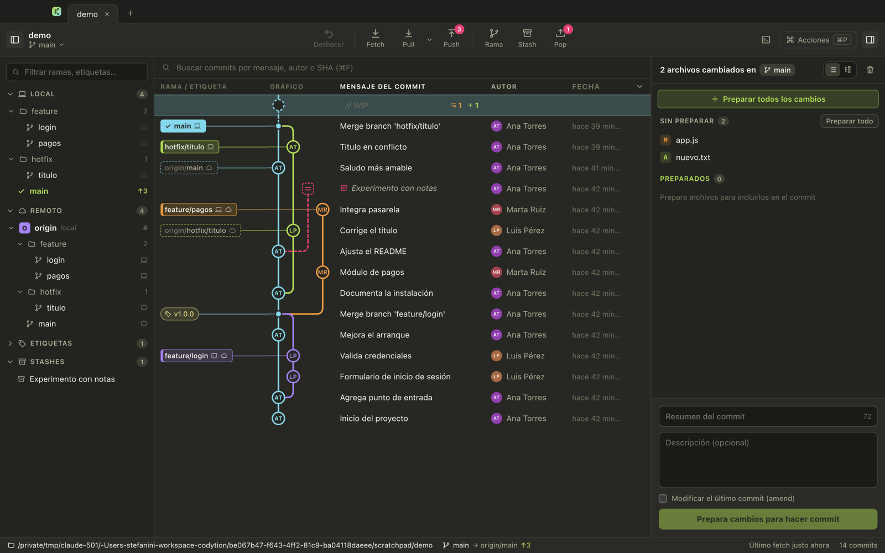
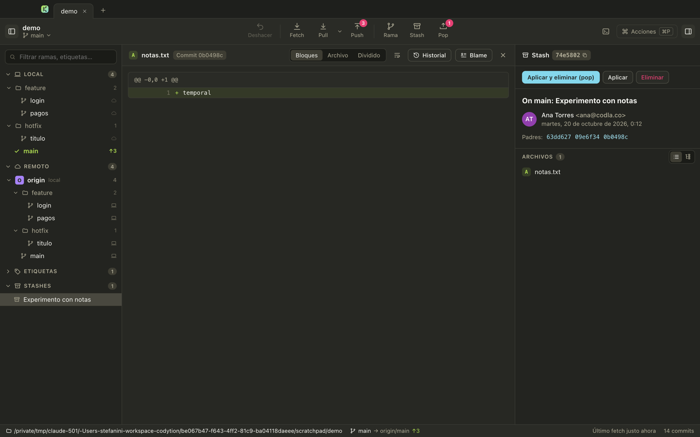
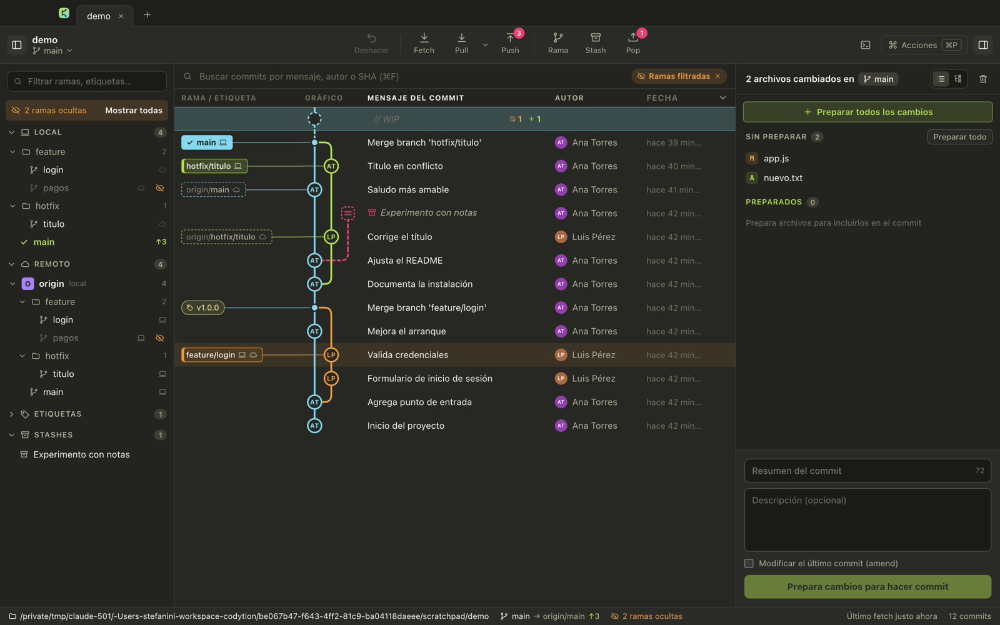
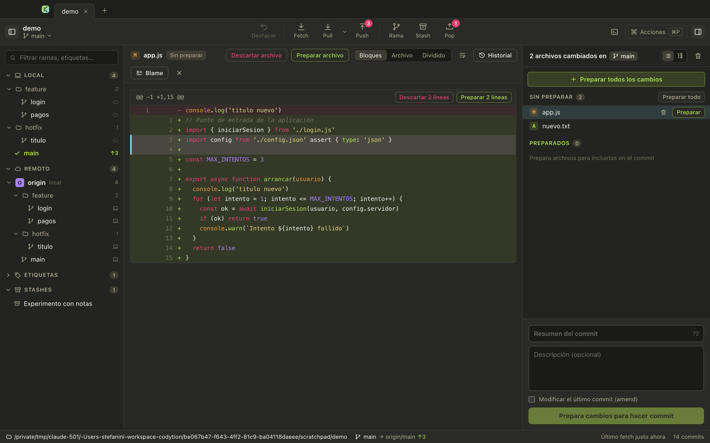
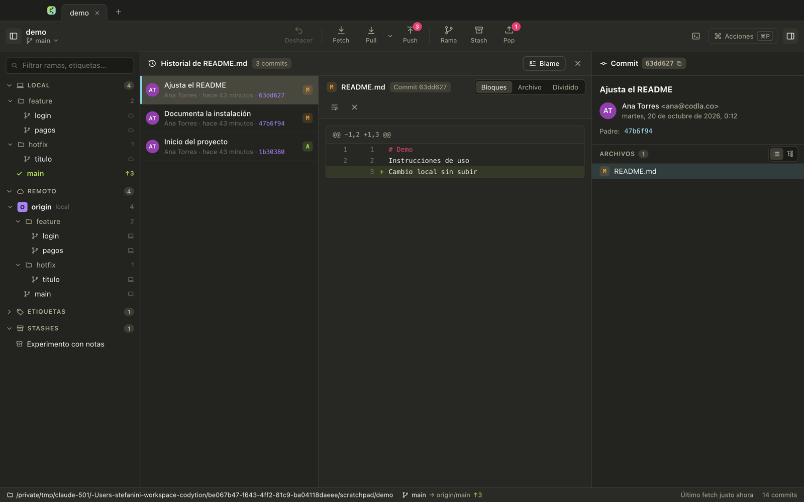
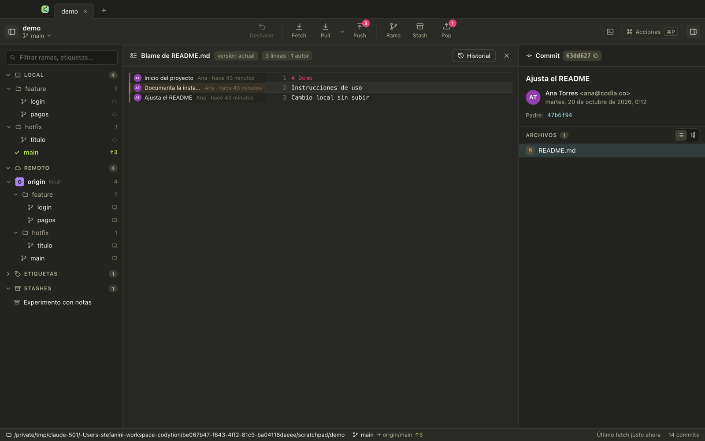
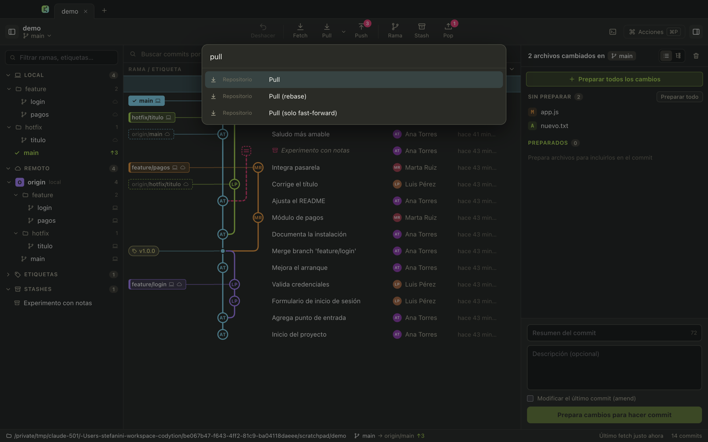

# Codyken

Cliente Git de escritorio hecho con Electron, React y TypeScript, con tema oscuro Monokai. Usa el `git` instalado en el equipo; no reimplementa Git.



> Las capturas usan un repositorio de demostración (`main`, `feature/login`, `feature/pagos`, `hotfix/titulo`, una etiqueta y un stash).

## Documentación

La documentación completa (arquitectura, capa git, algoritmos del gráfico, interfaz, flujos de trabajo, tests y decisiones) está en la bóveda de Obsidian [`codyken-obsidian/`](codyken-obsidian/00%20-%20Inicio.md): ábrela en Obsidian con *Abrir carpeta como bóveda* y empieza por `00 - Inicio`.

## Uso

```bash
npm install
npm run dev        # app con recarga en caliente
npm run build      # compila a out/
npm start          # abre la versión compilada
npm test           # tests (gráfico, parser de diffs, staging parcial y git real)
npm run typecheck
```

Requiere Node 22 o superior y `git` en el PATH.

## Distribución de la ventana

| Zona | Qué tiene |
|---|---|
| **Pestañas** (arriba) | Un repositorio por pestaña; se restauran al abrir la app. |
| **Barra de acciones** | Deshacer · Fetch · Pull (con menú de modos) · Push · Rama · Stash · Pop · Terminal · Acciones (⌘P). Los globos indican commits por subir/bajar y stashes guardados. |
| **Panel izquierdo** | Local, Remoto, Etiquetas, Stashes y Submódulos, con carpetas por prefijo (`feature/…`) y filtro. |
| **Centro** | Gráfico de commits; lo reemplaza el diff, el historial o el blame cuando abres un archivo (Esc vuelve). |
| **Panel derecho** | Cambios pendientes y caja de commit, o el detalle del commit/stash seleccionado. |
| **Barra de estado** | Ruta, rama y su remota (↑ por subir, ↓ por bajar), operación en curso, filtros activos, último fetch. |

## Gráfico de commits

- **Orden cronológico**, como GitKraken: cada merge queda junto al commit que integra, así los carriles son cortos aunque haya muchas ramas de despliegue.
- **La rama actual siempre va en la primera columna**; las demás salen de ella.
- Cada commit es un círculo con las **iniciales del autor**; los merges son un punto y HEAD lleva un anillo.
- Las **etiquetas de rama** se unen a su commit con una línea del color del carril. Si la rama local y la remota apuntan al mismo commit se muestran juntas (💻 ☁); las que solo están en el remoto salen punteadas. `+n` despliega todas al pasar el ratón.
- Fila **`// WIP`** arriba con el conteo de cambios; ahí mismo puedes escribir el resumen del commit.
- Al pasar sobre una rama del panel izquierdo se resalta su commit.
- Búsqueda por mensaje, autor o SHA (⌘F, Enter salta al siguiente), columnas configurables con clic derecho en el encabezado, carga de 2000 commits por página y lista virtualizada.
- **Arrastra** una etiqueta de rama sobre otra para hacer merge o rebase.

### Stashes en el gráfico

Cada stash es un nodo cuadrado punteado colgado del commit donde se guardó. Al seleccionarlo, el panel derecho muestra sus archivos (incluidos los nuevos guardados con `-u`) y los botones **Aplicar y eliminar (pop)**, **Aplicar** y **Eliminar**. Clic derecho abre el mismo menú.



### Ocultar ramas

El ojo junto a cada rama, carpeta o remoto la quita del gráfico; una rama local se oculta junto con su remota para que sus commits desaparezcan de verdad. Desde el clic derecho también está **Mostrar solo esta rama**. El filtro se guarda por repositorio y se avisa en la búsqueda (“Ramas filtradas”), en el panel y en la barra de estado.



## Panel izquierdo

- **Local**: ☁ si la rama está al día con su remota (tenue si existe en el remoto pero no la sigue), `↑n`/`↓n` si difiere, `local` si nunca se subió, ✓ en la rama actual.
- **Remoto**: agrupado por remoto con su servidor (github.com, gitlab…); 💻 si también tienes esa rama en local.
- **Etiquetas**, **Stashes** y **Submódulos** (doble clic abre el submódulo en otra pestaña).
- Doble clic en una rama hace checkout; clic derecho abre checkout, merge, rebase, crear rama o etiqueta, renombrar, eliminar (local o remota), ocultar y copiar nombre.

## Cambios y commit

- Archivos en **lista o árbol de carpetas**; se puede preparar o quitar una carpeta entera, o todo con **Preparar todos los cambios**.
- Staging **por archivo, por bloque o por línea**: clic en las líneas (Mayús para un rango) y luego “Preparar n líneas” o “Descartar n líneas”.
- Diff con **resaltado de sintaxis Monokai**, resaltado dentro de la línea y tres modos: Bloques, Archivo completo y Dividido.
- Resumen + descripción con contador de 72 caracteres y opción de **amend**.



## Historial y blame de un archivo

Desde los botones **Historial** y **Blame** del diff, o con clic derecho sobre un archivo.

- **Historial**: todos los commits que tocaron el archivo, siguiendo renombres, con el diff de cada uno al lado. Doble clic lleva al commit en el gráfico.
- **Blame**: cada línea con el commit, autor y fecha que la introdujo, agrupadas por commit y coloreadas; las líneas sin confirmar se marcan aparte. Clic en el bloque abre ese commit.





## Deshacer

Botón **Deshacer** (y ⌘Z) para commit, amend, checkout, crear/eliminar/renombrar rama, crear/eliminar etiqueta, merge, rebase, pull, cherry-pick, revert y reset. El tooltip dice qué se va a deshacer.

- Solo deshace si HEAD sigue donde lo dejó la acción; si cambiaste algo desde la terminal, avisa y no toca nada.
- Deshacer un commit devuelve sus cambios a preparados y recupera el mensaje en la caja de commit.
- Lo que necesita `reset --hard` (merge, pull, rebase…) pide confirmación y que no tengas cambios sin confirmar.
- Descartar cambios y eliminar stashes no se pueden deshacer: git no guarda esos datos.

## Remotos y conflictos

- **Fetch** trae todo de todos los remotos sin tocar tus ramas; también corre solo cada 10 minutos.
- **Pull** en tres modos (fast-forward si es posible, solo fast-forward, rebase) con modo predeterminado elegible.
- **Push** crea la rama remota si falta y, si el remoto la rechaza, ofrece `--force-with-lease`.
- Durante un merge, rebase o cherry-pick aparece un aviso con **Abortar** / **Continuar**; los archivos en conflicto se abren con los marcadores resaltados y botones “Usar versión HEAD”, “Usar versión entrante” y “Marcar resuelto”.

## Paleta de comandos

⌘P abre una búsqueda aproximada sobre todas las acciones, el checkout de cualquier rama, saltar a una rama en el gráfico y abrir repositorios recientes.



## Atajos

| Acción | Atajo |
|---|---|
| Paleta de comandos | ⌘P |
| Buscar commits | ⌘F |
| Filtrar ramas | ⌥⌘F |
| Nueva rama | ⌘B |
| Fetch | ⌘L |
| Preparar todo / quitar todo | ⇧⌘S / ⇧⌘U |
| Escribir mensaje de commit | ⇧⌘M |
| Commit / preparar todo y commit | ⌘Enter / ⇧⌘Enter |
| Deshacer la última acción | ⌘Z |
| Panel izquierdo / derecho | ⌘J / ⌘K |
| Moverse por el gráfico | ↑ ↓ o J K |
| Preparar / quitar el archivo abierto | S / U |
| Cerrar diff, historial o blame | Esc |
| Abrir repo · nueva pestaña · cerrar pestaña | ⌘O · ⌘T · ⌘W |
| Ir a la pestaña N | ⌘1 … ⌘9 |

## Estructura

```
src/main/       proceso principal: git.ts (todas las operaciones), watcher, ajustes, IPC
src/preload/    puente seguro (contextIsolation + sandbox)
src/shared/     tipos y contrato de la API
src/renderer/   React: components/ (vistas) y lib/ (gráfico, diff, parches, resaltado, búsqueda)
tests/          vitest
codyken-obsidian/  documentación completa (bóveda de Obsidian); Adjuntos/capturas/ tiene las imágenes de este README
```

Seguridad: el renderer no tiene acceso a Node; solo llama a métodos de una lista cerrada. Git se ejecuta sin shell (argumentos en arreglo), sin pedir credenciales por terminal (`GIT_TERMINAL_PROMPT=0`, SSH en modo batch) y solo sobre repos que abriste.

### Capturas

Hay un modo de captura solo para desarrollo, que usa sus propios ajustes y no toca los tuyos:

```bash
npx electron-vite build
CODYKEN_SNAPSHOT=foto.png CODYKEN_OPEN=/ruta/repo npx electron .
```

Opcionales: `CODYKEN_SNAPSHOT_JS` (script que se ejecuta en la ventana antes de la foto, para abrir vistas), `CODYKEN_SNAPSHOT_DELAY` y `CODYKEN_SNAPSHOT_SETTLE` (esperas en ms).

## Hoja de ruta

- **v2**: rehacer, rebase interactivo, comparar dos commits, terminal integrada, empaquetado `.dmg` firmado (electron-builder).
- **v3**: integraciones (pull requests de GitHub/GitLab), worktrees, LFS, perfiles con identidad git distinta, editor de conflictos de tres paneles.
