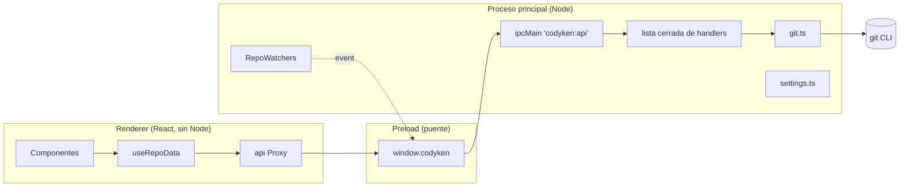

# 🗺️ Visión General

Codyken es una app de escritorio que **muestra y opera repositorios Git** con una interfaz gráfica: gráfico de commits, ramas locales y remotas, staging por línea, diffs, historial, blame, stashes, conflictos y sincronización con el remoto.

## 🧩 Piezas

| Capa | Carpeta | Responsabilidad |
|---|---|---|
| Proceso principal | `src/main/` | Ventana, menús, diálogos, IPC, ejecución de `git`, vigilancia de archivos, ajustes |
| Preload | `src/preload/` | Expone `window.codyken` con `invoke`, `onRepoChanged` y `platform` |
| Compartido | `src/shared/types.ts` | Tipos y el contrato `Api` que ambos lados cumplen |
| Renderer | `src/renderer/src/` | React: `components/` (vistas), `lib/` (gráfico, diff, parches, resaltado, búsqueda) |

## 🔄 Ciclo de un dato

1. `RepoView` monta `useRepoData(repo, filtro)`.
2. `refreshAll` pide en paralelo **refs, estado, status, stashes, log, submódulos y remotos** (ver [[02 - Capa Git/Lectura del Repositorio]]).
3. Cada llamada viaja por el canal único `codyken:api` (ver [[01 - Arquitectura/Procesos e IPC]]) y el main ejecuta `git` sin shell.
4. El renderer calcula el gráfico ([[03 - Algoritmos/Gráfico de Carriles]]) y las etiquetas ([[03 - Algoritmos/Etiquetas de Ramas]]) y pinta una lista virtualizada.
5. Cuando cambian archivos o refs, [[02 - Capa Git/Vigilancia y Refresco|el watcher]] avisa y se recarga solo lo necesario.

## 🎯 Principios

- **Git es la autoridad**: Codyken no guarda estado del repo propio; todo se relee de `git`.
- **Nada destructivo sin confirmar** y, cuando se puede, con [[03 - Algoritmos/Pila de Deshacer|deshacer]].
- **Errores con la salida real de git**, traducidos al español cuando aportan contexto.
- **Todo el texto visible en español.**
- Diseño propio: se toman patrones de uso de GitKraken, no su código ni sus recursos (ver [[Decisiones]]).
